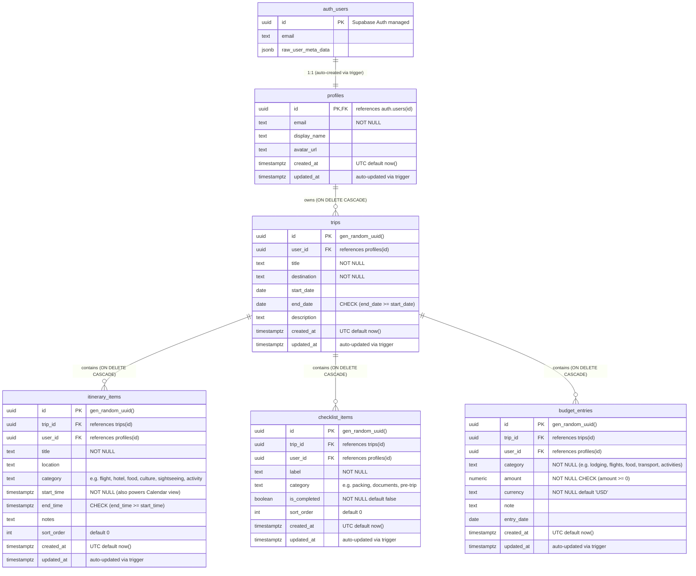

# RoamReady Database Schema & ER Diagram (Lane A: Data & Trips)

> **Location:** Kept next to [`supabase/migrations/`](./migrations/) as the living data schema reference for the backend team and course documentation.  
> **Last Updated:** November 18, 2026

---

## Entity-Relationship Diagram

---

## Table List & Naming Conventions

| Table | Status | Owner Column | Parent FK (Cascade Delete) | Notes |
| :--- | :--- | :--- | :--- | :--- |
| `public.profiles` | **Active (Week 1)** | `id` | `auth.users(id)` | Auto-created on Email & Google signup via `on_auth_user_created` trigger. |
| `public.trips` | **Active (Week 1)** | `user_id` | `public.profiles(id)` | Enforces `end_date >= start_date`, indexed on `(user_id, start_date DESC)`. |
| `public.itinerary_items` | **Planned (Week 2)** | `user_id` | `public.trips(id)` | **Single source of truth for Calendar & Itinerary views** (`start_time`, `end_time`, `category`). |
| `public.checklist_items` | **Planned (Week 2)** | `user_id` | `public.trips(id)` | Supports Packing lists & pre-trip To-Dos per trip. |
| `public.budget_entries` | **Planned (Week 2)** | `user_id` | `public.trips(id)` | Tracks estimated or actual expenses (`numeric(10,2)`, non-negative). |

---

## Shared Backend Conventions

1. **Row-Level Security (RLS):** Every user-owned table enables RLS with four explicit policies (`SELECT`, `INSERT`, `UPDATE`, `DELETE`) checking `auth.uid() = user_id` (or `auth.uid() = id` on `profiles`).
2. **Ownership Verification on Child Tables:** In addition to checking `auth.uid() = user_id`, `INSERT` and `UPDATE` policies on child tables (`itinerary_items`, `checklist_items`, `budget_entries`) verify that the referenced `trip_id` belongs to `auth.uid()`.
3. **Timestamps & Triggers:** All tables include `created_at` and `updated_at` (`timestamptz` in UTC), maintained automatically by `public.set_updated_at()`.
4. **Migration Discipline:** Existing applied migrations are never edited. All schema changes are added as new timestamped `.sql` files in `supabase/migrations/`.
5. **Calendar Strategy:** Calendar entries are derived directly from `itinerary_items` (`start_time`, `end_time`, `category`) so there is one source of truth and zero sync drift between the Itinerary page and Calendar page.
